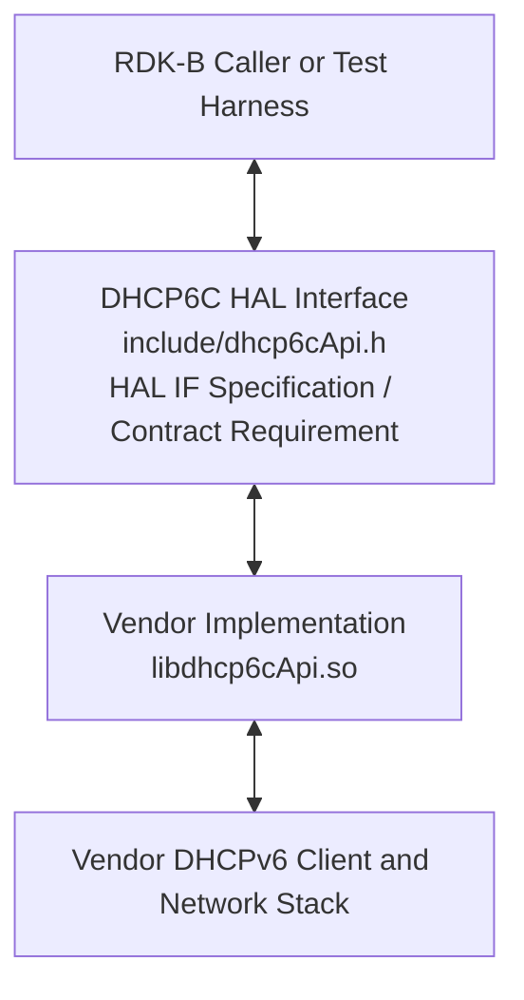
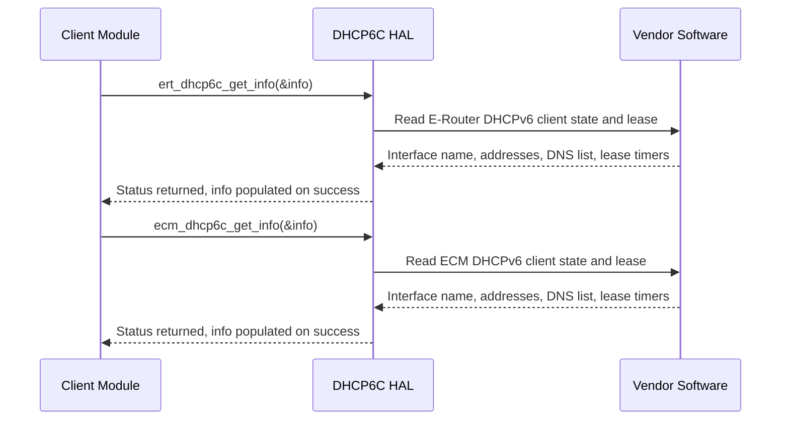

# DHCP6C HAL Documentation

## Version History

| Date | Comment | Version |
| --- | --- | --- |
| 2024-07-19 | Initial release. DHCP6C HAL interface header migrated to GitHub under RDKB-52499. | 1.0.0 |
| 2024-09-16 | Maintenance release. `CHANGELOG.md` records the addition of the `dhcp6cInfo_t` structure to `dhcp6cApi.h`. | 1.0.1 |
| 2026-08-24 | Specification rewritten to the canonical RDK-B HAL topic set: both declared APIs named under `API Surface`, the public types and defines documented, the four version identities separated, the observable state values enumerated, and the previously unresolved footprint and timeout requirements replaced with explicit statements. Describes the interface at tag `1.0.1`. | Unreleased |

**Provenance of this page.** It was renamed from `docs/pages/DHCP6ChalSpec.md` to `docs/pages/halSpec.md` in the same change that rewrote it against the canonical topic set. Git records a rename only where the two versions still resemble each other, and a full rewrite does not, so `git log --follow -- docs/pages/halSpec.md` begins at that change: the revisions before it are reached with `git log -- docs/pages/DHCP6ChalSpec.md`.

Dates come from `CHANGELOG.md` where it records one — it dates `1.0.0` as 19 July 2024. It records **no** date for `1.0.1`, so the date above is the date of the `1.0.1` tag. The last row is not covered by a release tag, so it is marked `Unreleased` rather than given a number this repository has not issued.

Four version identities exist around this interface, and a reader who conflates them will draw the wrong conclusion about what a caller can rely on:

- **Document revision** \- the `Version` column above. This document is the first revision recorded for this specification.
- **Release tag** \- the nearest tag is `1.0.1`, which is the release this document describes. The repository carries exactly two tags, `1.0.0` and `1.0.1`.
- **Interface version** \- **none exists.** `include/dhcp6cApi.h` defines no version macro of any kind, so a caller can neither test the interface revision at compile time nor read it at run time, and cannot compile conditionally against one. See `Variability Management`.
- **Generated-site version string** \- `docs/generate_docs.sh` derives `PROJECT_VERSION` from `git describe --tags`, which yields a string of the form `<tag>-<commits since that tag>-g<abbreviated commit>` whenever the tree is ahead of a tag. That string identifies a position in history, not a version of the interface or of this document, and must not be read as one.

*Derived from `CHANGELOG.md`, this repository's tag list, `include/dhcp6cApi.h` and `docs/generate_docs.sh`.*

## Acronyms

- `API` \- Application Programming Interface
- `DHCP` \- Dynamic Host Configuration Protocol
- `DHCPv6` \- Dynamic Host Configuration Protocol for IPv6
- `DHCP6C` \- DHCPv6 Client, the subject of this interface
- `DNS` \- Domain Name System
- `ECM` \- Embedded Cable Modem
- `E-Router` \- Edge Router, as the declaration comments in `include/dhcp6cApi.h` expand it; abbreviated `ERT` in this interface's identifiers
- `HAL` \- Hardware Abstraction Layer
- `IPv6` \- Internet Protocol version 6
- `OEM` \- Original Equipment Manufacturer
- `RDK-B` \- Reference Design Kit for Broadband Devices
- `SLA` \- Service Level Agreement

*The `ECM` and `E-Router` expansions are taken from the declaration comments in `include/dhcp6cApi.h`; the remainder are the terms this document itself uses.*

## Description

The diagram below describes a high-level software architecture of the DHCP6C HAL module stack.

The DHCP6C `HAL` is the `RDK-B` interface for **reading the state of a device's `DHCPv6` clients**. It sits between higher-level `RDK-B` software and a vendor's `DHCPv6` client implementation, so that a caller can obtain the address, prefix, gateway, `DNS` and lease timing a client currently holds without depending on which implementation provides it or which platform it runs on.

This repository holds the interface definition only. The implementation behind it is supplied by a vendor — in practice the `OEM` or the silicon supplier — and the caller is `RDK-B` software that needs the client state.

The surface is deliberately narrow, and its shape is the most important thing to understand about it. This interface declares **two functions and no others**, both of which read: one for the `E-Router` `DHCPv6` client and one for the `ECM` `DHCPv6` client. There is no call that configures a client, starts or stops one, renews or releases a lease, or subscribes to a change. A caller reads a snapshot; it does not drive the protocol.

**No dedicated `RDK-B` middleware service owns this interface.** Most HALs in this corpus are driven by one owning service, and the caller of the `HAL` is that service. The `RDK-B` inventory records no such service for DHCP6C: it appears in no row of the inventory's table of services to stop before exercising a `HAL` directly, and is listed among the components that have no service dependency. The caller is therefore whichever `RDK-B` component or test harness needs `DHCPv6` client state, and it links the vendor library directly. There is consequently no service to stop before exercising this interface, and no service whose state a caller must take into account.

*Derived from `include/dhcp6cApi.h` (the file-level description and the complete declared surface) and the `RDK-B` superproject `README.md`, which summarizes this component as a small read-mostly surface over the vendor's DHCPv6 client for lease and configuration state and records the absence of an owning service. Where the two differed, the header governed.*

## Optional Components

This interface declares **no optional build-time components**. Its only preprocessor conditional is the include guard `_DHCP6_CLIENT_API_`, which exists to make repeated inclusion safe and selects nothing. There is no feature macro, configuration flag or conditional block that adds or removes any part of the interface, so both declarations, both defines and the one structure are present in every build.

One form of optionality is nonetheless visible in the interface itself, and it is a matter of **applicability rather than of build configuration**:

- `ert_dhcp6c_get_info` reads the client its declaration identifies as the `E-Router` (Edge Router) `DHCPv6` client.
- `ecm_dhcp6c_get_info` reads the client its declaration identifies as the `ECM` (Embedded Cable Modem) `DHCPv6` client, which exists only on a product that has an embedded cable modem.

Beyond those two names, this interface does not define what distinguishes the two clients, and it does not describe the network role of either. Both functions are declared unconditionally on every platform, so a product without an embedded cable modem still presents `ecm_dhcp6c_get_info` to its callers. This interface does **not** state what an implementation returns when the client a caller asks about is not present on the product, so a caller must not read a failure from either function as evidence that the client is absent, nor a success as evidence that it exists.

*Derived from `include/dhcp6cApi.h` — the include guard, the unconditional declarations, and the `@brief` on each that identifies which client it reads.*

## Component Runtime Execution Requirements

The requirements in this block govern how an implementation behaves at run time and what a caller may rely on. Where this interface does not establish a behavior, that is stated explicitly rather than filled in, because a caller that assumes an unstated behavior — or a test that asserts one — will be wrong on some vendor implementation.

### Initialization and Startup

**This interface has no initialization or teardown entry point.** It declares no `init`, `deinit`, `open`, `close`, `start` or `stop` call, returns no handle or context, and takes no descriptor. A caller reads values without opening or closing a session, and there is nothing to tear down when it has finished. The two functions it may call are:

- `ert_dhcp6c_get_info()` \- retrieves the current state and configuration of the `E-Router` `DHCPv6` client.
- `ecm_dhcp6c_get_info()` \- retrieves the current state and configuration of the `ECM` `DHCPv6` client.

No dependent `API` has to be initialized before either of them is invoked, and no `RDK-B` component has to be started first.

What must be ready is the vendor side. Bringing up and configuring the `DHCPv6` client itself is the responsibility of the vendor implementation and of whatever component manages network configuration on the product; none of that work is reachable through this interface. Third-party vendors will implement these functions appropriately to meet operational requirements, and this interface is expected to block if the hardware is not ready. That expectation sits in tension with the non-blocking requirement stated under `Blocking calls`, which records the conflict and what a caller should do about it.

Beyond the vendor-side readiness above, this interface states no ordering requirement between its two functions, and a caller must not infer one from the order in which they are declared.

*Derived from `include/dhcp6cApi.h` — the complete declared surface, which contains no lifecycle function — and from this repository's previous specification revision, whose statement about hardware readiness is retained.*

### Threading Model

This interface is **not inherently required to be thread-safe**. It is the responsibility of the calling module or component to ensure that all interactions with the APIs are properly synchronized.

Vendors may implement internal threading and event mechanisms to meet their operational requirements. Those mechanisms must be designed to ensure thread safety when interacting with the `HAL` interface, and proper cleanup of allocated resources — memory, file handles, threads — is mandatory when the vendor software terminates or closes its connection to the `HAL`.

**Implementation Guidance for Vendors:**

Vendors are free to use internal threading or event mechanisms within their implementation as needed to fulfill operational requirements. However, any such mechanisms must:

- **Synchronize Access:** Implement appropriate synchronization primitives, such as mutexes or semaphores, to prevent race conditions and ensure data integrity when accessing the APIs.
- **Resource Management:** Ensure proper cleanup and release of any resources, such as memory and threads, allocated during the lifetime of the instance, especially during module shutdown or disconnection.

Because the caller carries the synchronization obligation, two consequences follow for a caller reading the same client from more than one thread: it must serialize its own calls, and it must not share one `dhcp6cInfo_t` between concurrent calls. This interface does not state which fields of that structure a call writes, nor in what order, so two calls sharing one instance may interleave their writes and leave a caller reading a mixture of two retrievals.

*Derived from this repository's previous specification revision, which states the thread-safety position, corroborated against `include/dhcp6cApi.h`, which declares no lock, handle or context through which an implementation could serialize on the caller's behalf.*

### Process Model

All APIs are expected to be called from multiple processes. Due to this concurrent access, vendors must implement protection mechanisms within their API implementations to handle multiple processes calling the same API simultaneously. This is crucial to ensure data integrity, prevent race conditions, and maintain the overall stability and reliability of the system.

This is compatible with the single-threaded expectation stated under `Blocking calls`: the two constrain different things. Several processes may hold this interface at once, while each individual caller is expected to drive it from one thread and therefore to need calls that return rather than suspend.

*Derived from this repository's previous specification revision, which states the multiple-process expectation, corroborated against `include/dhcp6cApi.h`: the group-level statement carried by both declarations' shared documentation block (`:207-209`) records that an implementation must expect calls from several processes and protect its own state accordingly, and cites this topic for the requirement rather than establishing it. The header declares no process affinity, no lock and no shared context anywhere, so nothing in it constrains how that protection is achieved.*

### Memory Model

#### Caller Responsibilities

- **Allocate and own the output structure.** Both functions take a single `dhcp6cInfo_t *` out-parameter. The caller allocates that structure and owns it throughout; when it releases it is the caller's decision, qualified by the bullet below. This interface allocates nothing on the caller's behalf and hands out no memory the caller must free, because it declares no function that returns a pointer and no release call.
- **Keep it valid for longer than the call, because retention is unstated.** This interface does not state whether an implementation retains the out-parameter pointer after the call returns, so a caller must not treat the return as the moment the structure becomes free to release or reuse, and must not rely on the implementation having copied out of it. Keep the structure valid while the component continues to read through this interface.
- **Do not share one structure across concurrent calls.** Each call fills the structure it is passed, and this interface does not state which fields it writes, so two concurrent calls into the same instance may interleave their writes. See `Threading Model`.
- **Treat the structure as caller-managed for its whole lifetime.** Manage memory passed to specific functions as outlined in the API documentation, including allocation and deallocation, to prevent leaks.
- **Zero-terminate every string.** All strings used in this module must be zero-terminated, so that string functions can accurately determine their length and buffer manipulation cannot overrun. Note that this rule applies to the interface's character fields and not to its address fields: `ipAddr`, `prefix`, `gw`, `dhcpServer` and each entry of `dnsAddrList` are fixed-length raw byte arrays rather than strings, and are described under `Data Structures and Defines`.

#### Module Responsibilities

- Modules must allocate and de-allocate memory for their internal operations, ensuring efficient resource management.
- Modules are required to release all internally allocated memory upon closure to prevent resource leaks.
- All module implementations and caller code must strictly adhere to these memory management requirements for optimal performance and system stability, unless otherwise stated specifically in the API documentation.
- **Pointer retention is not settled by this interface, and this specification does not settle it either.** Neither `include/dhcp6cApi.h` nor any other file in this repository states whether an implementation may hold the caller's `dhcp6cInfo_t` pointer beyond the call it was passed to, and there is no deregistration call through which a retained pointer could later be released. This specification records that gap rather than converting it into a prohibition the interface never imposed: an implementation that does retain the pointer contradicts nothing here. The obligation the gap creates falls on the caller and is stated under `Caller Responsibilities`.

**No memory footprint limit is specified for this interface.** Neither `include/dhcp6cApi.h` nor any other file in this repository states a maximum resident size, a heap ceiling or an allocation budget for an implementation, so neither a caller nor an integrator may assume one, and a test must not assert one. See `Memory and performance requirements`.

*Derived from `include/dhcp6cApi.h` — the `dhcp6cInfo_t` out-parameter on both declarations and the field types of that structure — and from this repository's previous specification revision, whose caller and module obligations are retained.*

### Power Management Requirements

The `HAL` is not involved in any of the power management operation. It neither participates in nor requires involvement in power state transitions, wake event configuration or resource throttling, and it declares no API for any of them.

*Derived from this repository's previous specification revision, corroborated against `include/dhcp6cApi.h`, which declares no power management function.*

### Asynchronous Notification Model

**There are no asynchronous notifications.** This interface declares no callback typedef, no registration function and no event or notification `API` of any kind, so there is nothing for a caller to register, nothing to unregister, and no path by which an implementation can call back into a caller.

The consequence for a caller is concrete and worth stating, because the alternative is easy to assume: a caller that needs to observe a lease being acquired, renewed, rebound or lost must **poll** `ert_dhcp6c_get_info()` or `ecm_dhcp6c_get_info()` and compare successive results. The state machine position, the configuration attempt count and the lease timers in `dhcp6cInfo_t` are the fields a caller compares between reads, and every member of that structure is described under `Data Structures and Defines`. This interface specifies no polling interval, and specifies neither the age nor the update rate of the values it returns, so a caller cannot determine from the interface how stale a returned value may be.

*Derived from `include/dhcp6cApi.h`, which declares two functions and no callback, registration or notification mechanism, and from this repository's previous specification revision.*

### Blocking calls

**Synchronous and Responsive:** All APIs within this module should operate synchronously and complete within a reasonable timeframe based on the complexity of the operation. Both functions return a status directly, so a caller learns the outcome at the call site.

**Non-Blocking Requirement:** Given the single-threaded environment in which these APIs will be called, it is imperative that they do not block or suspend execution of the main thread. Implementations must avoid long-running operations, or use asynchronous mechanisms internally where necessary, to maintain responsiveness.

**A stated conflict on hardware readiness:** this specification has made two claims that cannot both hold. `Initialization and Startup` states that the interface is expected to block if the hardware is not ready, and the requirement above states that these APIs must not block or suspend the calling thread. Both are statements of this repository's specification rather than of the interface definition, and `include/dhcp6cApi.h` establishes neither. The declarations record that conflict themselves and reach the same conclusion this topic does: they state that the interface does not establish whether the call may block, that the outcome is nonetheless delivered synchronously as the return value, and that a failure is to be treated as a possible "not ready yet" rather than as a permanent condition, without binding an implementation to a duration either way. **This interface therefore does not establish whether `ert_dhcp6c_get_info()` or `ecm_dhcp6c_get_info()` may block, and a caller must not assume either behavior.** A caller that cannot tolerate a blocking call must place the call where a delay is survivable, and a test must not assert that either function returns within a bound this interface does not state.

**Timeout Handling:** **no timeout requirement is specified for this interface.** Neither `include/dhcp6cApi.h` nor any other file in this repository states a completion-time target, an upper bound or a recommended timeout for either function, and each declaration records that absence on itself rather than leaving a reader to infer it. A caller that needs a bound must impose and enforce its own, and should build resilience against an unresponsive implementation rather than relying on a limit this interface does not set.

*Derived from `include/dhcp6cApi.h` (the two declarations and their documented return contract) and from the two conflicting statements in this repository's previous specification revision.*

### Internal Error Handling

**Synchronous Error Handling:** All APIs must return errors synchronously as a return value. This ensures immediate notification of errors to the caller.

**Internal Error Reporting:** The `HAL` is responsible for reporting any internal system errors, such as an out-of-memory condition, through the return value.

**Focus on Logging for Errors:** For system errors, the `HAL` should prioritize logging the error details for further investigation and resolution. See `Logging and debugging requirements`.

Both functions return `int`, and the outcomes their declarations document are `STATUS_SUCCESS` for a successful retrieval and `STATUS_FAILURE` for an error while retrieving the information. Three properties of that contract matter to a caller and are stated rather than assumed:

1. **Neither name is defined by this interface.** `STATUS_SUCCESS` and `STATUS_FAILURE` appear only inside the documentation comments on the two declarations. No file in this repository defines either of them, so a caller obtains them from the platform's common `RDK-B` status definitions and **must not assume a numeric value** for either, in code or in a test assertion. `Data Structures and Defines` records the same point against the interface's public defines.
2. **Failures are not distinguishable.** One failure value covers every reason a retrieval can fail — an absent client, an unprepared vendor implementation, an invalid argument — and this interface provides no error code, no error string and no retrieval function through which a caller could learn which occurred. The log is the only place the reason can be found, which is why `Logging and debugging requirements` treats logging as load-bearing rather than optional.
3. **The state of the output structure after a failure is unspecified.** Both declarations state this of themselves: on a failure the structure may be left untouched, partly written or fully written, and all three are permitted, so a caller must not read any field of it unless the call reported success. The same declarations also decline to state that members an implementation could not read are zeroed, so an unset member must not be read as a zero value on a successful call either.

*Derived from `include/dhcp6cApi.h` (the `@returns` and `@retval` documentation on both declarations), from a repository-wide search that finds no definition of either status name, and from this repository's previous specification revision.*

### Persistence Model

There is no requirement for `HAL` to persist any setting information. The caller is responsible to persist any settings related to their implementation.

The distinction between persistence and lease state is worth drawing, because a reader may expect this interface to hold something. It holds nothing: every value a caller reads is owned by the vendor's `DHCPv6` client and is retrieved on demand, and this interface has no setting of its own to store. In particular `leaseGotTime`, `remainLeaseTime`, `remainRenewTime` and `remainRebindTime` are read at the moment of the call and are not preserved by this interface across a call, a process restart or a reboot.

*Derived from `include/dhcp6cApi.h` (the read-only surface and the timer fields of `dhcp6cInfo_t`) and from this repository's previous specification revision.*

## Non functional requirements

The following non-functional requirements apply to any implementation of this interface.

### Logging and debugging requirements

The component is required to record all errors and critical informative messages to aid in identifying, debugging, and understanding the functional flow of the system. Logging should be implemented using the `syslog` method, as it provides robust logging capabilities suited for system-level software. The use of `printf` is discouraged unless `syslog` is not available.

All `HAL` components must adhere to a consistent logging process. When logging is necessary, it should be performed into the `dhcp6c_vendor_hal.log` file, which is located in either the `/var/tmp/` or `/rdklogs/logs/` directories.

Logs must be categorized according to the following log levels, as defined by the Linux standard logging system, listed here in descending order of severity:

- **FATAL:** Critical conditions, typically indicating system crashes or severe failures that require immediate attention.
- **ERROR:** Non-fatal error conditions that nonetheless significantly impede normal operation.
- **WARNING:** Potentially harmful situations that do not yet represent errors.
- **NOTICE:** Important but not error-level events.
- **INFO:** General informational messages that highlight system operations.
- **DEBUG:** Detailed information typically useful only when diagnosing problems.
- **TRACE:** Very fine-grained logging to trace the internal flow of the system.

Each log entry should include a timestamp, the log level, and a message describing the event or condition. This standard format will facilitate easier parsing and analysis of log files across different vendors and components.

Because a single failure value is the only failure information this interface defines, as `Internal Error Handling` records, the log is the only place a caller can look for the reason behind a failed retrieval. An implementation should log enough detail on failure — which client was asked for, and what prevented the read — to make the cause identifiable without reproducing it.

*Derived from this repository's previous specification revision, which names the log file and the severity ladder.*

### Memory and performance requirements

**Client Module Responsibility:** The client module using the `HAL` is responsible for allocating and deallocating memory for any data structures required by the `HAL`'s APIs. This includes structures passed as parameters to `HAL` functions and any buffers used to receive data from the `HAL`.

**Vendor Implementation Responsibility:** Third-party vendors, when implementing the `HAL`, may allocate memory internally for their specific operational needs. It is the vendor's sole responsibility to manage and deallocate this internally allocated memory.

**No memory footprint limit is specified for this interface**, and no completion-time target is specified either; `Memory Model` and `Blocking calls` state each in full. An implementation should not contribute disproportionately to memory or `CPU` utilization during normal operation, and its resource use should be commensurate with the operation requested.

One property does follow from the declarations and is worth planning around: the data a caller receives is a **fixed-size structure** with no variable-length or callee-allocated part, so the transfer cost of a call does not grow with the state of the client. The cost of obtaining that state inside the vendor implementation is not specified by this interface.

*Derived from `include/dhcp6cApi.h` (the fixed-size `dhcp6cInfo_t` and the absence of any callee allocation) and from this repository's previous specification revision.*

### Quality Control

To ensure the highest quality and reliability, it is strongly recommended that third-party quality assurance tools like `Coverity`, `Black Duck`, and `Valgrind` be employed to thoroughly analyze the implementation. The goal is to detect and resolve potential issues such as memory leaks, memory corruption, or other defects before deployment.

Furthermore, both the `HAL` wrapper and any third-party software interacting with it must prioritize robust memory management practices. This includes meticulous allocation, deallocation, and error handling to guarantee a stable and leak-free operation. The ownership rules this interface defines are stated under `Memory Model`; the short form is that the caller owns the one structure that crosses the interface.

**Documentation freshness.** Every topic here closes with an italic line naming, in that topic's own body, the source its content derives from, and any change to a source so cited obliges a review of the topics that cite it. The sources are `include/dhcp6cApi.h`, `CHANGELOG.md`, `CONTRIBUTING.md`, `docs/generate_docs.sh`, the `RDK-B` superproject `README.md`, and this repository's previous specification revision — the last of these wherever a statement predates this revision and nothing in the header establishes it, in which case the topic says so. A renamed, added or removed declaration is the trigger that matters most, because every identifier this document names is asserted to exist in the header. This repository defines no `CODEOWNERS` file, so the responsible reviewer is the maintainer group that `CONTRIBUTING.md` directs contributions to: raise an issue at `github.com/rdkcentral/rdkb-halif-dhcp6c/issues` and open a pull request for review, which that document states the team reviews and merges.

**Verification limit.** The `RDK-B` inventory records that this `HAL` has no owning middleware service and **is not available on the HUB6 or XER10 reference platforms**, so exercising it requires other hardware. Every runtime statement in this document is therefore derived from the interface definition — the two declarations and their documentation comments in `include/dhcp6cApi.h` — and from this repository's own specification. **None of it has been confirmed by executing the `HAL` on reference hardware, and none of it is presented as observed behavior.** Where this interface does not establish a behavior, this document says so rather than supplying a plausible value.

*Derived from this repository's previous specification revision, `CONTRIBUTING.md`, the absence of a `CODEOWNERS` file in this repository, and the `RDK-B` superproject `README.md` for platform availability.*

### Licensing

The DHCP6C `HAL` implementation is expected to be released under the Apache License 2.0. The interface header in this repository carries that license notice, and the full text is available at the repository root as `LICENSE`, with `COPYING` and `NOTICE` alongside it.

*Derived from the license notice at the top of `include/dhcp6cApi.h` and the repository-root license files.*

### Build Requirements

The source code should be capable of, but not be limited to, building under the Yocto distribution environment. The recipe should deliver a shared library named as `libdhcp6cApi.so`.

That name is a requirement placed on a vendor's recipe rather than an artefact of this repository. This repository ships the interface header, its documentation, its legal files and a unit-test bootstrap script; it contains no implementation, no recipe and no build manifest for the library. A caller compiles against `include/dhcp6cApi.h` and links the vendor-supplied `libdhcp6cApi.so`, as `Interface API Documentation` states.

*Derived from this repository's previous specification revision, corroborated against the repository's tracked file list.*

### Variability Management

The role of adjusting the interface, guided by versioning, rests solely within architecture requirements. Thereafter, vendors are obliged to align their implementation with a designated version of the interface. As per Service Level Agreement (`SLA`) terms, they may transition to newer versions based on demand needs.

Each API interface will be versioned using [Semantic Versioning 2.0.0](https://semver.org/spec/v2.0.0.html), and the vendor code will comply with a specific version of the interface.

Two facts qualify that for this interface in particular, and both are stated because a reader would otherwise assume the corpus norm:

- **There is no compile-time variability.** `include/dhcp6cApi.h` defines **no** feature macro that adds or removes a declaration — this interface has no equivalent of the `MOCA_VAR` flag some other `RDK-B` HALs use — and `docs/generate_docs.sh` passes no additional preprocessor definitions to the documentation generator. Its only conditional is the include guard. Every declaration is present in every build, and there is no variant of this interface to select.
- **There is no interface version macro.** The header defines no version constant, so a caller cannot interrogate the interface revision at compile time or at run time and cannot compile conditionally against one. The only version identity available is the repository's release tag; see `Version History`.

*Derived from `include/dhcp6cApi.h` (its complete macro set — the include guard, `IPV6_ADDR_SIZE` and `MAX_IPV6_ADDR_LIST_SIZE`) and `docs/generate_docs.sh`.*

### Platform or Product Customization

This interface specifies **no platform or product customization surface**. It defines no vendor extension point, no product-specific macro, no optional declaration group and no configuration file, so the same two declarations, two defines and one structure are presented to every caller on every platform.

Product-specific behavior is therefore confined entirely to the vendor implementation behind the interface, where it is neither visible to a caller nor selectable through this interface. The one product-dependent distinction the interface does expose is which of the two `DHCPv6` clients a product actually has, and that is a matter of applicability rather than of customization; `Optional Components` states it, including the fact that this interface does not define what an implementation returns for a client the product does not have.

*Derived from `include/dhcp6cApi.h`, which declares no customization mechanism.*

## Interface API Documentation

All `HAL` function prototypes and datatype definitions are available in the `dhcp6cApi.h` file.

1. Components/Process must include `dhcp6cApi.h` to make use of DHCP6C `HAL` capabilities.
2. Components/Process should add linker dependency for `libdhcp6cApi.so`.

### Theory of operation and key concepts

This topic describes how the objects and calls of this interface relate to one another — the relationship an integrator needs in order to sequence calls correctly and to interpret a result, and which is not recoverable from the two signatures alone.

The interface has one central concept: a **`DHCPv6` client**, owned and operated by the vendor implementation, whose current configuration and lease state this interface reports. There are two such clients, one for the `E-Router` and one for the `ECM`, and each has exactly one accessor. Everything this interface does is a read of one of them.

#### Object Lifecycles

- **No Explicit Object Creation:** The DHCP6C `HAL` interface does not involve explicit creation or destruction of objects within the `HAL` itself. The primary "object" in this context is the `DHCPv6` client configuration and state information, which is maintained by the underlying vendor implementation.
- **Data Retrieval:** The `HAL` APIs (`ert_dhcp6c_get_info` and `ecm_dhcp6c_get_info`) are designed to retrieve existing `DHCPv6` client information from the vendor implementation and populate a `dhcp6cInfo_t` structure provided by the caller. The lifecycle of this structure is managed by the calling module.
- **No Handle and No Instance:** Neither function takes or returns a handle, a context or an interface identifier, so a caller cannot address more than one client of either kind through this interface, and cannot hand a client to another component. Which client is read is fixed by which function is called.

#### Method Sequencing

- **No Strict Sequencing:** There is no explicit requirement for a specific order in which the methods must be called. However, it is implied that the initialization and configuration of the `DHCPv6` client within the vendor implementation would happen before the `HAL` APIs are used to retrieve information.
- **Initialization Responsibility:** The responsibility for initializing and configuring the `DHCPv6` client lies with the vendor implementation and potentially with higher-level components that manage the network configuration.
- **The two accessors are independent:** neither is a precondition of the other, and calling one has no effect on what the other returns. A caller that needs both clients' state calls both, and should treat the two results as read at two different moments rather than as one consistent snapshot.

#### State-Dependent Behavior

- **Implicit State Dependency:** While not explicitly stated, the behavior of the `HAL` APIs is inherently state-dependent. The information returned by the `ert_dhcp6c_get_info` and `ecm_dhcp6c_get_info` functions will depend on the current state of the `DHCPv6` client within the vendor implementation.
- **Potential Blocking:** The interface may block if the underlying hardware is not ready, so the calls can behave differently according to the state of the underlying system. `Blocking calls` records that this specification also states the opposite, and that the interface settles neither.
- **The returned state is a snapshot, and its meaning is only partly defined.** `smState` reports the client's state machine position as a bare `int`, and this interface defines no value set for it; the timer fields are counted down by the vendor client and change between reads. `State Diagram` enumerates every state value a caller can observe and states what this interface does and does not establish about them.

*Derived from `include/dhcp6cApi.h` — the two declarations, their `dhcp6cInfo_t` out-parameter and the documented meaning of each field — and from this repository's previous specification revision, whose lifecycle and sequencing statements are retained.*

### Data Structures and Defines

Every public type and valued macro a caller constructs, populates or interprets is listed here. All three are declared in [`include/dhcp6cApi.h`](../../include/dhcp6cApi.h), between the include guard and the `DHCPV6C_HAL_APIS` Doxygen group, and the header documents each structure member on the member itself — so the generated reference is the place to read a field's own description, and this topic is the index to it.

| Definition | Kind | Represents |
| --- | --- | --- |
| `IPV6_ADDR_SIZE` | macro, value `16` | Size of an `IPv6` address in bytes, and the width of every address field in `dhcp6cInfo_t`. |
| `MAX_IPV6_ADDR_LIST_SIZE` | macro, value `3` | Maximum number of `DNS` addresses the structure can carry, and therefore the capacity of `dnsAddrList`. |
| `dhcp6cInfo_t` | struct typedef, 16 members | One `DHCPv6` client's identity, assigned addressing, `DNS` list and lease timing, as reported by the vendor implementation. |

**`dhcp6cInfo_t`** is the only structure this interface defines. It is allocated by the caller and filled by the implementation — never the other way round — and it is the sole out-parameter of both functions. Its members are, in declaration order:

| Member | Type | Constraint | Meaning |
| --- | --- | --- | --- |
| `ifname` | `char[32]` | Zero-terminated, 32 bytes including the terminator | Network interface name. |
| `smState` | `int` | No value set is defined by this interface | Position of the client's state machine. See `State Diagram`. |
| `configAttemps` | `int` | Not bounded by this interface | Number of configuration attempts. Spelled as shown in the declaration. |
| `ipAddr` | `unsigned char[16]` | Exactly `IPV6_ADDR_SIZE` raw bytes | `IPv6` address assigned to the interface. |
| `prefix` | `unsigned char[16]` | Exactly `IPV6_ADDR_SIZE` raw bytes | Network prefix for the assigned `IPv6` address. |
| `gw` | `unsigned char[16]` | Exactly `IPV6_ADDR_SIZE` raw bytes | `IPv6` address of the gateway. |
| `dhcpServer` | `unsigned char[16]` | Exactly `IPV6_ADDR_SIZE` raw bytes | `IPv6` address of the `DHCP` server. |
| `t1` | `unsigned int` | Unit not stated by this interface | Renewal time (T1) for the lease. |
| `t2` | `unsigned int` | Unit not stated by this interface | Rebinding time (T2) for the lease. |
| `leaseTime` | `unsigned int` | Unit not stated by this interface | Total lease time for the address. |
| `leaseGotTime` | `unsigned int` | Epoch and unit not stated by this interface | Timestamp at which the lease was obtained. |
| `remainLeaseTime` | `unsigned int` | Unit not stated by this interface | Remaining lease time for the address. |
| `remainRenewTime` | `unsigned int` | Unit not stated by this interface | Remaining time to renewal (T1). |
| `remainRebindTime` | `unsigned int` | Unit not stated by this interface | Remaining time to rebind (T2). |
| `numOfDns` | `int` | Bounds the valid range of `dnsAddrList` | Number of `DNS` addresses present in the list. |
| `dnsAddrList` | `unsigned char[3][16]` | `MAX_IPV6_ADDR_LIST_SIZE` entries of `IPV6_ADDR_SIZE` raw bytes | List of `DNS` server `IPv6` addresses. |

Three facts about that structure decide whether a caller reads it correctly, and none of them is visible from the member names:

1. **The address fields are raw bytes, not presentation-format strings.** `ipAddr`, `prefix`, `gw`, `dhcpServer` and each entry of `dnsAddrList` are `unsigned char` arrays of exactly `IPV6_ADDR_SIZE` bytes — the wire form of an `IPv6` address. A caller that needs a textual address must format the bytes itself, and must not pass any of these fields to a string function or print it as text.
2. **`numOfDns` bounds the valid index range of `dnsAddrList`.** The array's capacity is `MAX_IPV6_ADDR_LIST_SIZE`, which is `3`, and `numOfDns` reports how many of those entries are populated. A caller must read entries `0` to `numOfDns - 1` only; this interface does not state what the remaining entries contain, and does not state whether an implementation may report a `numOfDns` greater than the capacity, so a defensive caller clamps the count to `MAX_IPV6_ADDR_LIST_SIZE` before indexing.
3. **The interface's two status names are not defined here, or anywhere in this repository.** `STATUS_SUCCESS` and `STATUS_FAILURE` are named in the return documentation of both functions, but this header defines neither, and no other file in this repository defines them either. They come from the platform's common `RDK-B` status definitions, and a caller must compare against those definitions rather than against an assumed numeric value. `Internal Error Handling` states the consequences.

There are **no callback typedefs** in this interface, and no function-pointer members in the structure; `Asynchronous Notification Model` records what follows from that.

*Derived from `include/dhcp6cApi.h` — the two defines, the `dhcp6cInfo_t` declaration and its per-member documentation comments — and from a repository-wide search that finds no definition of either status name.*

### API Surface

This interface declares **two** functions, both listed below by exact identifier. They are the whole of it: there is no third declaration, no setter, and no lifecycle call.

This topic is also the boundary between the two ways of reading this document. A reader who came for an overview can stop above it; a reader with a question about a specific call, a field or a state starts here.

Per-API detail — the argument's direction and ownership, the pre-conditions, every return value and what a caller should do about each — is carried by the Doxygen block on each declaration in [`include/dhcp6cApi.h`](../../include/dhcp6cApi.h). Both declarations sit inside that header's `DHCPV6C_HAL_APIS` Doxygen group, in the order shown, so the generated reference presents them together on one page. Line numbers are deliberately not cited: the header's documentation comments change as they are maintained, so a line reference would go stale, whereas the identifiers and the group name will not.

**DHCPv6 client information retrieval (2):**

| API | Declared in | Purpose |
| --- | --- | --- |
| `ert_dhcp6c_get_info` | [`include/dhcp6cApi.h`](../../include/dhcp6cApi.h), first declaration of `DHCPV6C_HAL_APIS` | Retrieves the current state and configuration of the `E-Router` `DHCPv6` client into a caller-allocated `dhcp6cInfo_t`. Returns a status; the structure's contents are meaningful only on success. |
| `ecm_dhcp6c_get_info` | [`include/dhcp6cApi.h`](../../include/dhcp6cApi.h), second declaration of `DHCPV6C_HAL_APIS` | Retrieves the current state and configuration of the `ECM` (Embedded Cable Modem) `DHCPv6` client into a caller-allocated `dhcp6cInfo_t`. Returns a status; the structure's contents are meaningful only on success. |

Both take one argument, `dhcp6cInfo_t *pInfo`, which is an out-parameter the caller allocates and owns, and both return `int`. They differ only in which client they read.

*Derived from `include/dhcp6cApi.h` — the complete set of declarations in the header, and the `@brief`, `@param` and return documentation on each.*

### Sequence Diagram

The exchange below walks the whole interface — both calls, in either order — using the real identifiers. The vendor legs name the work the implementation performs rather than being left blank, so the diagram states what each call implies behind the interface.

Three properties of this diagram are contractual rather than illustrative. The caller allocates the `dhcp6cInfo_t` before the first call, and no leg of the exchange transfers ownership of memory in either direction. Nothing precedes the first call: there is no initialization leg because the interface declares no initialization function. And the two calls are shown one after another only to name both in one place — they are independent, either may be called without the other, and a caller that needs both clients' state should not treat the two results as a single consistent snapshot.

*Derived from `include/dhcp6cApi.h` — the two declarations, their single out-parameter and their return contract.*

### State Diagram

**No state diagram is drawn for this interface, and that is a statement about the contract rather than an omission.** This interface exposes state as values a caller reads. It does not define which values `smState` may take, which transitions between them are legal, in what order they occur, or which event causes one — so any diagram drawn here would assert a state machine the interface does not establish. A caller polls, as `Asynchronous Notification Model` describes, and interprets the values below.

The state a caller can observe is entirely the content of `dhcp6cInfo_t`, and these are the fields that carry it:

- **Client state machine position** \- `smState`, an `int` documented as the position of the client's state machine and nothing further. **No enumeration, macro or comment anywhere in this repository defines its value set**, which the declaration states of itself, so a caller cannot map a returned number to a meaning from this interface, and a test cannot assert on a named state. A caller that must interpret it has to obtain the mapping from its vendor, and must not carry over the values used by the `DHCPv4` client interfaces.
- **Configuration progress** \- `configAttemps`, the number of configuration attempts made. This interface states no bound on it and no threshold at which an implementation stops trying, so a rising value indicates repeated attempts and nothing more.
- **Lease timing** \- `t1` and `t2`, the renewal and rebinding times; `leaseTime`, the total lease duration; `leaseGotTime`, the moment the lease was obtained; and `remainLeaseTime`, `remainRenewTime` and `remainRebindTime`, the amounts remaining. This interface states no unit and no epoch for any of them, so a caller must not assume seconds, milliseconds or any particular reference point.
- **Assignment presence** \- `ipAddr`, `prefix`, `gw`, `dhcpServer` and `numOfDns` together describe what the client currently holds. This interface does not define a value that means "unassigned", so a caller cannot reliably distinguish an unassigned field from an assigned one whose bytes happen to be zero.

The `DHCPv6` protocol does define a client state machine, and its states are named in `RFC 8415`. That is **external context and not this interface's contract**: nothing here maps `smState` onto those names, states that a client passes through them in a given order, or constrains which value follows which. This document deliberately does not reproduce that state machine, because doing so would present as an interface guarantee something a vendor implementation is free to number differently.

Beyond the values enumerated above, **this interface specifies no state transitions and no state-dependent restrictions on either call.** Both functions are readable at any time, subject only to the vendor-side readiness recorded under `Initialization and Startup`.

*Derived from `include/dhcp6cApi.h` — the `smState`, `configAttemps`, timer and address members of `dhcp6cInfo_t` and their documentation comments — and from a repository-wide search that finds no enumeration or macro defining any state value.*
