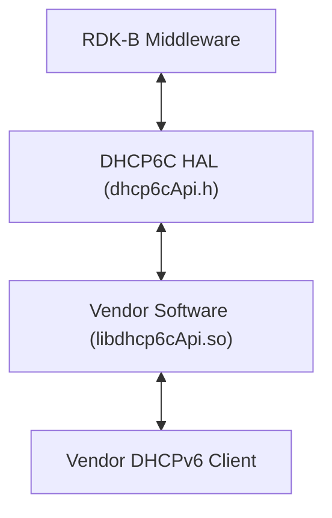
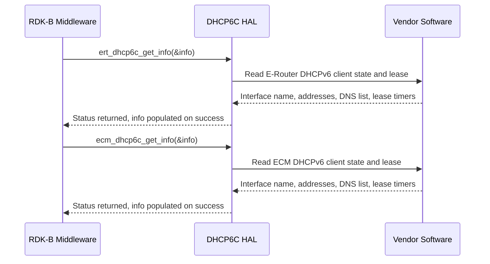

# DHCP6C HAL Documentation

## Version History

| Date | Comment | Version |
| --- | --- | --- |
| 2024-07-19 | Initial release. DHCP6C HAL interface header migrated to GitHub under RDKB-52499. | 1.0.0 |
| 2024-09-16 | Maintenance release. The repository-root changelog records the addition of the `dhcp6cInfo_t` structure to `dhcp6cApi.h`. | 1.0.1 |
| 2026-08-24 | Specification rewritten to the canonical RDK-B HAL topic set: both declared APIs named under `API Surface`, the public types and defines documented, the four version identities separated, the observable state values enumerated, and the previously unresolved footprint and timeout requirements replaced with explicit statements. Describes the interface at tag `1.0.1`. | Unreleased |

## Acronyms

- `API` \- Application Programming Interface
- `CPU` \- Central Processing Unit
- `DHCP` \- Dynamic Host Configuration Protocol
- `DHCPv6` \- Dynamic Host Configuration Protocol for IPv6
- `DHCP6C` \- DHCPv6 Client, the subject of this interface
- `DNS` \- Domain Name System
- `ECM` \- Embedded Cable Modem
- `E-Router` \- Edge Router, abbreviated `ERT` in this interface's identifiers
- `HAL` \- Hardware Abstraction Layer
- `IPv6` \- Internet Protocol version 6
- `OEM` \- Original Equipment Manufacturer
- `RDK-B` \- Reference Design Kit for Broadband Devices
- `SLA` \- Service Level Agreement

## Description

The diagram below describes a high-level software architecture of the DHCP6C HAL module stack.

The DHCP6C `HAL` is the `RDK-B` interface for **reading the state of a device's `DHCPv6` clients**. It sits between the RDK-B Middleware and the vendor's `DHCPv6` client implementation, so that a caller obtains the address, prefix, gateway, `DNS` and lease timing a client currently holds without depending on which implementation provides it or which platform it runs on. This repository holds the interface definition only; the implementation is supplied by the vendor, in practice the `OEM` or the silicon supplier.

The interface declares **two functions, both reads**: one for the `E-Router` `DHCPv6` client and one for the `ECM` `DHCPv6` client. No call configures, starts or stops a client, renews or releases a lease, or subscribes to a change. A caller reads a snapshot; it does not drive the protocol.

**No dedicated `RDK-B` middleware service owns this interface.** The caller, shown as RDK-B Middleware in the diagrams, is any `RDK-B` component that needs `DHCPv6` client state. It links the vendor library directly, so no service has to be stopped before the interface is exercised.

## Optional Components

This interface has **no optional build-time components**. Both functions, both defines and `dhcp6cInfo_t` are declared unconditionally; the include guard `_DHCP6_CLIENT_API_` is the header's only preprocessor conditional.

Optionality exists only as **applicability**, which depends on the product rather than on the build:

- `ert_dhcp6c_get_info` reads the `E-Router` `DHCPv6` client.
- `ecm_dhcp6c_get_info` reads the `ECM` `DHCPv6` client, which exists only on a product with an embedded cable modem. The function is nevertheless declared on every platform.

Neither function's result indicates whether its client is present on the product: a failure is not evidence that the client is absent, and a success is not evidence that it exists.

## Component Runtime Execution Requirements

The requirements in this block govern how an implementation behaves at run time and what a caller may rely on.

### Initialization and Startup

**This interface has no initialization or teardown entry point.** A caller reads values without opening or closing a session. The two functions it may call are:

- `ert_dhcp6c_get_info()` \- retrieves the current state and configuration of the `E-Router` `DHCPv6` client.
- `ecm_dhcp6c_get_info()` \- retrieves the current state and configuration of the `ECM` `DHCPv6` client.

No dependent `API` has to be initialized before either of them is invoked, and no `RDK-B` component has to be started first.

What must be ready is the vendor side. Bringing up and configuring the `DHCPv6` client is the responsibility of the vendor implementation and of whatever component manages network configuration on the product; none of that work is reachable through this interface. Third-party vendors will implement these functions appropriately to meet operational requirements. `Blocking calls` states how a call behaves before the hardware is ready.

### Threading Model

This interface is **not inherently required to be thread-safe**. It is the responsibility of the calling module or component to ensure that all interactions with the APIs are properly synchronized.

**Implementation Guidance for Vendors:**

Vendors are free to use internal threading or event mechanisms within their implementation as needed to fulfill operational requirements. However, any such mechanisms must:

- **Synchronize Access:** Implement appropriate synchronization primitives, such as mutexes or semaphores, to prevent race conditions and ensure data integrity when accessing the APIs.
- **Resource Management:** Ensure proper cleanup and release of any resources, such as memory and threads, allocated during the lifetime of the instance, especially during module shutdown or disconnection.

A caller that reads from more than one thread must serialize its own calls and must not share one `dhcp6cInfo_t` between concurrent calls, because two calls filling one instance may interleave their writes.

### Process Model

All APIs are expected to be called from multiple processes. Due to this concurrent access, vendors must implement protection mechanisms within their API implementations to handle multiple processes calling the same API simultaneously. This is crucial to ensure data integrity, prevent race conditions, and maintain the overall stability and reliability of the system.

### Memory Model

The only memory that crosses this interface is the `dhcp6cInfo_t` a caller passes to either function. The interface allocates nothing on the caller's behalf and returns no memory for the caller to free.

#### Caller Responsibilities

- Allocate the `dhcp6cInfo_t` passed to each call, and release it; manage it as outlined in the API documentation to prevent leaks.
- Keep the structure valid for as long as the component continues to call this interface, unless the vendor documents that the implementation does not retain the pointer after a call returns.

#### Module Responsibilities

- Modules must allocate and de-allocate memory for their internal operations, ensuring efficient resource management.
- Modules are required to release all internally allocated memory upon closure to prevent resource leaks.
- All strings a module returns must be zero-terminated, so that string functions can determine their length without overrunning the buffer.

### Power Management Requirements

The `HAL` is not involved in any power management operation: it neither participates in nor requires involvement in power state transitions, wake event configuration or resource throttling.

### Asynchronous Notification Model

**There are no asynchronous notifications.** A caller that needs to observe a lease being acquired, renewed, rebound or lost **polls** `ert_dhcp6c_get_info()` or `ecm_dhcp6c_get_info()` and compares successive results, typically the state machine position, the configuration attempt count and the lease timers in `dhcp6cInfo_t`.

### Blocking calls

**Synchronous and Responsive:** All APIs within this module should operate synchronously and complete within a reasonable timeframe based on the complexity of the operation. Both functions return their outcome directly, so a caller learns it at the call site.

**Non-Blocking Requirement:** Given the single-threaded environment in which these APIs will be called, it is imperative that they do not block or suspend execution of the main thread. Implementations must avoid long-running operations, or use asynchronous mechanisms internally where necessary, to maintain responsiveness.

**Hardware Readiness:** The interface is expected to block if the hardware is not ready. A caller therefore places each call where a delay is survivable, applies its own timeout where an unresponsive call would be a failure, and after a failure re-reads later rather than treating the client's state as permanently unavailable.

### Internal Error Handling

**Synchronous Error Handling:** All APIs must return errors synchronously as a return value. This ensures immediate notification of errors to the caller.

**Internal Error Reporting:** The `HAL` is responsible for reporting any internal system errors, such as an out-of-memory condition, through the return value.

**Focus on Logging for Errors:** For system errors, the `HAL` should prioritize logging the error details for further investigation and resolution. See `Logging and debugging requirements`.

Both functions return `int` and distinguish two outcomes:

| Outcome | Caller action |
| --- | --- |
| Retrieval succeeded | Read the members of `dhcp6cInfo_t`, within the bounds stated under `Data Structures and Defines`. |
| Retrieval failed | Do not read any member of the structure. Re-check the pointer passed, then treat the client's state as unavailable and re-read later rather than substituting a default such as a zero lease. |

Neither outcome has a symbolic name or a numeric value in this interface, so a caller compares the result against its platform's common `RDK-B` status definitions, as agreed with its vendor, and never against a literal. One failure outcome covers every cause, from an invalid argument to an unprepared vendor implementation; the cause is recorded only in the vendor log.

### Persistence Model

There is no requirement for `HAL` to persist any setting information. The caller is responsible to persist any settings related to their implementation.

Every value a caller reads is owned by the vendor's `DHCPv6` client and retrieved at the moment of the call; this interface stores nothing across a call, a process restart or a reboot.

## Non functional requirements

The following non-functional requirements apply to any implementation of this interface.

### Logging and debugging requirements

The component is required to record all errors and critical informative messages to aid in identifying, debugging, and understanding the functional flow of the system. Logging should be implemented using the `syslog` method, as it provides robust logging capabilities suited for system-level software. The use of `printf` is discouraged unless `syslog` is not available.

All `HAL` components must adhere to a consistent logging process. When logging is necessary, it should be performed into the `dhcp6c_vendor_hal.log` file, which is located in either the `/var/tmp/` or `/rdklogs/logs/` directories.

Logs must be categorized according to the following log levels, as defined by the Linux standard logging system, listed here in descending order of severity:

- **FATAL:** Critical conditions, typically indicating system crashes or severe failures that require immediate attention.
- **ERROR:** Non-fatal error conditions that nonetheless significantly impede normal operation.
- **WARNING:** Potentially harmful situations that do not yet represent errors.
- **NOTICE:** Important but not error-level events.
- **INFO:** General informational messages that highlight system operations.
- **DEBUG:** Detailed information typically useful only when diagnosing problems.
- **TRACE:** Very fine-grained logging to trace the internal flow of the system.

Each log entry should include a timestamp, the log level, and a message describing the event or condition. This standard format will facilitate easier parsing and analysis of log files across different vendors and components.

On a failed retrieval, an implementation should log which client was requested and what prevented the read, because the return value does not carry the cause.

Implementations must not log credentials, secrets, security-sensitive information, or other sensitive data.

### Memory and performance requirements

**Memory Ownership:** The caller allocates and releases every structure it passes to the `HAL`'s APIs, and the vendor manages and releases any memory its implementation allocates internally, as `Memory Model` states.

**Resource Use:** An implementation should not contribute disproportionately to memory or `CPU` utilization during normal operation, and its resource use should be commensurate with the operation requested. Each call returns a **fixed-size structure** with no variable-length or callee-allocated part, so the cost of transferring the result does not grow with the state of the client.

### Quality Control

To ensure the highest quality and reliability, it is strongly recommended that third-party quality assurance tools like `Coverity`, `Black Duck`, and `Valgrind` be employed to thoroughly analyze the implementation. The goal is to detect and resolve potential issues such as memory leaks, memory corruption, or other defects before deployment.

Furthermore, both the `HAL` wrapper and any third-party software interacting with it must prioritize robust memory management practices. This includes meticulous allocation, deallocation, and error handling to guarantee a stable and leak-free operation.

**Documentation Maintenance:** Any change to a file listed under `Source References` obliges a review of this document. The responsible reviewers are the repository maintainers: a change is raised as an issue at `github.com/rdkcentral/rdkb-halif-dhcp6c/issues` and submitted as a pull request, which the team reviews and merges, as `CONTRIBUTING.md` describes.

**Verification Limit:** This `HAL` is not available on the HUB6 or XER10 reference platforms, so the runtime behavior this document describes comes from the interface definition and has not been observed on reference hardware.

### Licensing

The DHCP6C `HAL` implementation is expected to be released under the Apache License 2.0. The interface header carries that license notice, and the full text is in the repository-root `LICENSE` file.

### Build Requirements

The source code should be capable of, but not be limited to, building under the Yocto distribution environment. The recipe should deliver a shared library named as `libdhcp6cApi.so`.

This repository supplies the interface header only; the library is built by the vendor's recipe.

### Variability Management

The role of adjusting the interface, guided by versioning, rests solely within architecture requirements. Thereafter, vendors are obliged to align their implementation with a designated version of the interface. As per Service Level Agreement (`SLA`) terms, they may transition to newer versions based on demand needs.

Each API interface will be versioned using [Semantic Versioning 2.0.0](https://semver.org/spec/v2.0.0.html), and the vendor code will comply with a specific version of the interface.

This interface has a single variant: no compile-time flag adds or removes any part of it (see `Optional Components`). Its version is identified by the repository's release tag rather than by a macro in the header.

### Platform or Product Customization

This interface has **no platform or product customization surface**: the same declarations, defines and structure are presented on every platform, and product-specific behavior is confined to the vendor implementation. Which `DHCPv6` clients a product has is a matter of applicability, described under `Optional Components`.

## Interface API Documentation

All `HAL` function prototypes and datatype definitions are available in the `dhcp6cApi.h` file.

1. Components/Process must include `dhcp6cApi.h` to make use of DHCP6C `HAL` capabilities.
2. Components/Process should add linker dependency for `libdhcp6cApi.so`.

### Theory of operation and key concepts

The interface has one central concept: a `DHCPv6` client, owned and operated by the vendor implementation, whose current configuration and lease state this interface reports. There are two such clients, one for the `E-Router` and one for the `ECM`, and each has exactly one accessor. Everything this interface does is a read of one of them.

#### Object Lifecycles

- **No Explicit Object Creation:** The DHCP6C `HAL` interface does not involve explicit creation or destruction of objects within the `HAL` itself. The primary "object" in this context is the `DHCPv6` client configuration and state information, which is maintained by the underlying vendor implementation.
- **Data Retrieval:** The `HAL` APIs (`ert_dhcp6c_get_info` and `ecm_dhcp6c_get_info`) are designed to retrieve existing `DHCPv6` client information from the vendor implementation and populate a `dhcp6cInfo_t` structure provided by the caller. The lifecycle of this structure is managed by the caller.
- **No Handle and No Instance:** Neither function takes or returns a handle, a context or an interface identifier; which client is read is fixed by which function is called.

#### Method Sequencing

- **No Strict Sequencing:** There is no requirement for a specific order in which the methods must be called. However, it is implied that the initialization and configuration of the `DHCPv6` client within the vendor implementation would happen before the `HAL` APIs are used to retrieve information.
- **Initialization Responsibility:** The responsibility for initializing and configuring the `DHCPv6` client lies with the vendor implementation and potentially with higher-level components that manage the network configuration.
- **Independent Accessors:** Neither function is a precondition of the other, and calling one has no effect on what the other returns. A caller that reads both treats the two results as taken at two different moments rather than as one consistent snapshot.

#### State-Dependent Behavior

- **Implicit State Dependency:** The information returned by `ert_dhcp6c_get_info` and `ecm_dhcp6c_get_info` depends on the current state of the `DHCPv6` client within the vendor implementation.
- **Potential Blocking:** A call made before the underlying hardware is ready may block; see `Blocking calls`.
- **Snapshot Values:** Each call returns a snapshot, and the lease timers count down between reads. `State Diagram` lists the state values a caller can observe.

### Data Structures and Defines

The public types and macros below are defined in `dhcp6cApi.h`, where each structure member also carries its own description.

| Definition | Kind | Represents |
| --- | --- | --- |
| `IPV6_ADDR_SIZE` | macro, value `16` | Size of an `IPv6` address in bytes, and the width of every address field in `dhcp6cInfo_t`. |
| `MAX_IPV6_ADDR_LIST_SIZE` | macro, value `3` | Maximum number of `DNS` addresses the structure can carry, and therefore the capacity of `dnsAddrList`. |
| `dhcp6cInfo_t` | struct typedef, 16 members | One `DHCPv6` client's identity, assigned addressing, `DNS` list and lease timing, as reported by the vendor implementation. |

`dhcp6cInfo_t` is the only structure this interface defines. It is allocated by the caller, filled by the implementation, and is the sole out-parameter of both functions. Its members are, in declaration order:

| Member | Type | Meaning |
| --- | --- | --- |
| `ifname` | `char[32]` | Network interface name, zero-terminated within the 32 bytes. |
| `smState` | `int` | Position of the client's state machine. See `State Diagram`. |
| `configAttemps` | `int` | Number of configuration attempts. Spelled as shown in the declaration. |
| `ipAddr` | `unsigned char[16]` | `IPv6` address assigned to the interface. |
| `prefix` | `unsigned char[16]` | Network prefix for the assigned `IPv6` address. |
| `gw` | `unsigned char[16]` | `IPv6` address of the gateway. |
| `dhcpServer` | `unsigned char[16]` | `IPv6` address of the `DHCP` server. |
| `t1` | `unsigned int` | Renewal time (T1) for the lease. |
| `t2` | `unsigned int` | Rebinding time (T2) for the lease. |
| `leaseTime` | `unsigned int` | Total lease time for the address. |
| `leaseGotTime` | `unsigned int` | Timestamp at which the lease was obtained. |
| `remainLeaseTime` | `unsigned int` | Remaining lease time for the address. |
| `remainRenewTime` | `unsigned int` | Remaining time to renewal (T1). |
| `remainRebindTime` | `unsigned int` | Remaining time to rebind (T2). |
| `numOfDns` | `int` | Number of populated entries in `dnsAddrList`. |
| `dnsAddrList` | `unsigned char[3][16]` | List of `DNS` server `IPv6` addresses. |

Three rules decide whether a caller reads the structure correctly:

1. **The address fields are raw bytes, not strings.** `ipAddr`, `prefix`, `gw`, `dhcpServer` and each entry of `dnsAddrList` hold exactly `IPV6_ADDR_SIZE` bytes in wire form. A caller that needs a textual address formats the bytes itself and never passes these fields to a string function.
2. **The count `numOfDns` bounds `dnsAddrList`.** A caller reads entries `0` to `numOfDns - 1` only, and never more than `MAX_IPV6_ADDR_LIST_SIZE` entries.
3. **Timer units come from the vendor.** The interface gives no unit or epoch for the timer members, so a caller confirms them with its vendor before converting any of them.

### API Surface

This interface declares **two** functions; there is no setter and no lifecycle call. Per-API detail, covering argument direction and ownership, pre-conditions, return values and the caller action for each, is in the Doxygen block on each declaration in `dhcp6cApi.h`, within the `DHCPV6C_HAL_APIS` group.

**DHCPv6 client information retrieval (2):**

| API | Purpose |
| --- | --- |
| `ert_dhcp6c_get_info` | Retrieves the current state and configuration of the `E-Router` `DHCPv6` client into a caller-allocated `dhcp6cInfo_t`. |
| `ecm_dhcp6c_get_info` | Retrieves the current state and configuration of the `ECM` `DHCPv6` client into a caller-allocated `dhcp6cInfo_t`. |

Both take one argument, `dhcp6cInfo_t *pInfo`, an out-parameter the caller allocates and owns, and both return `int`.

### Sequence Diagram

The exchange below shows both calls with their real identifiers; either call may be made without the other.

The Mermaid diagrams in this document render on GitHub; the generated Doxygen site shows their source text.

### State Diagram

This interface exposes state as values in `dhcp6cInfo_t` but defines no state transitions, so no state diagram is drawn. A caller polls, as `Asynchronous Notification Model` describes, and interprets these members:

- **Client state machine position** \- `smState`. Its values are vendor-defined, so a caller obtains their meaning from its vendor.
- **Configuration progress** \- `configAttemps`; a rising value indicates repeated configuration attempts.
- **Lease timing** \- `t1` and `t2`, the renewal and rebinding times; `leaseTime`, the total lease duration; `leaseGotTime`, the moment the lease was obtained; and `remainLeaseTime`, `remainRenewTime` and `remainRebindTime`, the time remaining.
- **Assignment** \- `ipAddr`, `prefix`, `gw`, `dhcpServer`, `numOfDns` and `dnsAddrList`, the addressing and `DNS` servers the client currently holds.

## Source References

- [rdkcentral/rdkb-halif-dhcp6c/include/dhcp6cApi.h](https://github.com/rdkcentral/rdkb-halif-dhcp6c/blob/develop/include/dhcp6cApi.h) — interface header: function declarations, `dhcp6cInfo_t`, defines and the per-API contract
- [rdkcentral/rdkb-halif-dhcp6c/CHANGELOG.md](https://github.com/rdkcentral/rdkb-halif-dhcp6c/blob/develop/CHANGELOG.md) — release history behind `Version History`
- [rdkcentral/rdkb-halif-dhcp6c/CONTRIBUTING.md](https://github.com/rdkcentral/rdkb-halif-dhcp6c/blob/develop/CONTRIBUTING.md) — contribution and review process named under `Quality Control`
- [rdkcentral/rdkb-halif-dhcp6c/LICENSE](https://github.com/rdkcentral/rdkb-halif-dhcp6c/blob/develop/LICENSE) — Apache License 2.0 text named under `Licensing`
